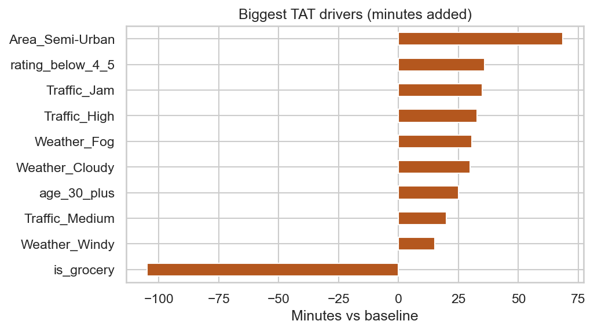
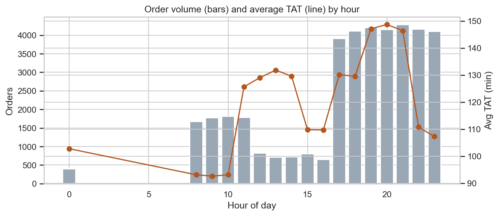

# Delivery TAT Analysis: Where and Why Do Orders Run Late?
Dashboard : https://deliverytatanalysis-gswhwgcjilj3wgj6tfcsz6.streamlit.app/ 
> An end-to-end operations analytics project on 43,739 real delivery orders: clean the data, find what drives delivery time, flag bad trends automatically, and turn the findings into recommendations.



## Business problem
Operations teams need to track Delivery TAT (turnaround time) and the late-order rate, find the causes of slow deliveries, catch bad trends early, and tell leadership what to fix first.

## Dataset
Public India-based delivery dataset from Kaggle ("Amazon Delivery Dataset"): order date and time, pickup time, store and drop coordinates, traffic, weather, vehicle, area, category, agent age and rating, and delivery time in minutes.

| Item | Value |
|---|---|
| Raw orders | 43,739 |
| Clean orders | 40,046 |
| Period | 11 Feb to 6 Apr 2022 (44 days with orders) |
| Cost data | None, so cost per shipment is not measured |
| Late threshold | Over 150 minutes (an assumption; median TAT is 125 min) |

## What this project shows
| Skill | Where |
|---|---|
| Data cleaning and validation | `pipeline.py`: every fix is counted and logged |
| Pandas / NumPy | KPI tables, haversine distance, percentiles, NumPy least-squares driver model |
| EDA | TAT by traffic, weather, area, vehicle, category, hour, day, distance, agent |
| SQL (CTEs, window functions) | Notebook section 9: `RANK`, `LAG`, share of total with `SUM() OVER ()` |
| Statistics | Kruskal-Wallis and Spearman tests |
| Automation | `kpi_report.py`: daily and weekly KPIs, z-score trend alerts, Excel report |
| Dashboard | `app.py` (Streamlit) |

## Data issues caught
- **3,693 orders (8.4%)** had a zero or invalid store coordinate and were removed. Their average TAT (122.9 min) and grocery share (6.6%) match the kept rows (125.1 min, 6.1%), so the removal does not bias results.
- **53 agent ratings above 5** and **38 agent ages under 18** were impossible and set to missing.
- **91 orders** had the text "NaN" for traffic and weather; "Metropolitian" was a spelling error in the source.
- **11 calendar days have no orders** (19 to 28 Feb and 22 Mar).

## Key results
| Metric | Result |
|---|---|
| Average / P90 TAT | 125.1 min / 195 min |
| Orders over 150 min | 28.0% (51.4% over 120 min, 14.7% over 180 min) |
| Grocery vs all other categories | 26.5 min vs 131.5 min at the same distance (9.6 vs 9.7 km) |
| Traffic effect | Low 101.5 min, Jam 148.0 min (+46 min) |
| Late-order concentration | Jam traffic in Metropolitan areas: 24.7% of orders, **44.6% of late orders** |
| Slowest time window | 7 to 9 pm: about 147 min, 46 to 48% late (mornings about 93 min) |
| Biggest model drivers | Semi-Urban area (+69 min), agent rating under 4.5 (+36 min), Jam traffic (+35 min), Fog (+31 min) |
| Distance effect | Only about 1.8 min per km |
| Model fit | R² 0.26 (base) to 0.65 (with agent flags and grocery split) |
| Alert days | None; weekly avg TAT stable at 122 to 130 min |



## Insights
- **Grocery is a different, much faster flow.** It averages 26.5 minutes against about 131 for every other category, at the same distance. Apart from grocery, categories differ by only a few minutes.
- **Late orders are concentrated.** Jam, Medium and High traffic in Metropolitan areas are 50.7% of orders but 76.1% of late orders.
- **Evenings are the weak spot.** TAT peaks at 7 to 9 pm, right when order volume is highest.
- **Agent quality matters.** Orders by agents rated under 4.5 take 165 to 190 minutes versus about 120 for higher-rated agents.
- **Semi-Urban is extremely slow** (239 min, 95% late) but only 0.3% of orders.

## Recommendations
| Priority | Finding | Action | KPI to track |
|---|---|---|---|
| 1 | Jam × Metropolitan causes 44.6% of late orders | Traffic-aware dispatch and realistic ETAs in jam conditions | % late in Jam × Metropolitan |
| 2 | 7 to 9 pm is the slowest window | Add rider capacity in the evening peak | % late by hour |
| 3 | Grocery runs about 5x faster | Find out why (store proximity, dispatch rules) and test it on other categories | Avg TAT by category |
| 4 | Low-rated agents are slower | Coaching and routing for agents rated under 4.5 | Avg TAT by rating band |

## Impact scenario (assumptions, not data)
For Jam × Metropolitan (4,983 late orders over 44 days), an assumed 20% reduction at an assumed INR 40 per late order gives about INR 39,864 over the period (about INR 906 per day). Both inputs are placeholders to be replaced with finance data; the notebook includes a sensitivity grid.

## Run it
```bash
pip install -r requirements.txt
# put the Kaggle file at data/amazon_delivery.csv
jupyter notebook delivery_tat_analysis.ipynb                     # full analysis (outputs already saved)
python kpi_report.py --data data/amazon_delivery.csv --sla 150   # KPI report, trend alerts, Excel file
streamlit run app.py                                             # interactive dashboard
```
`make_dummy_data.py` creates **fake** data for a smoke test only.

## Limitations
- Short period with a 10-day gap, so trends and alerts are indicative only.
- No cost data; "late" is an assumed 150-minute threshold you can change.
- The regression shows association, not proof of cause.
- Sharp step changes at agent age 30 and rating 4.5, and an average speed of about 6 km/h, suggest the public dataset may be partly synthetic. Confirm with real operations data before acting.
- Distance is straight-line from coordinates, and is correlated with traffic class.

## Tech
Python, pandas, NumPy, SciPy, matplotlib, seaborn, SQLite, Streamlit, Altair, openpyxl
